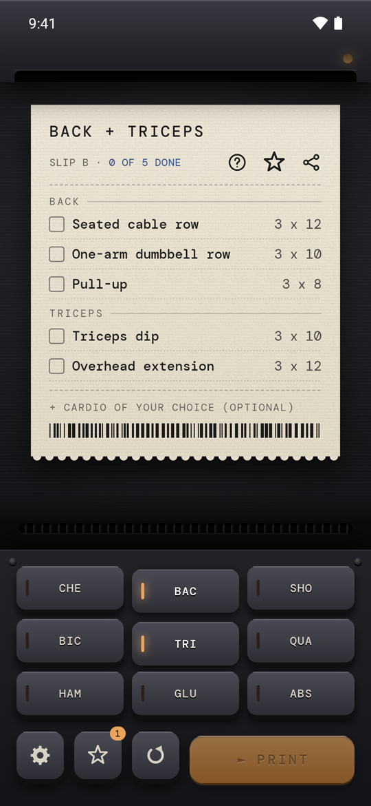
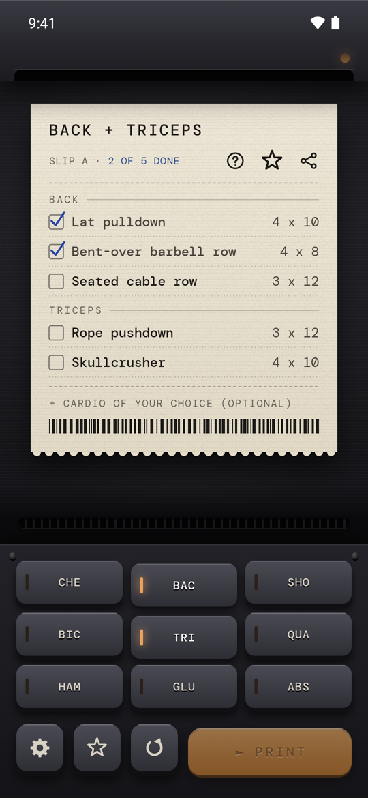
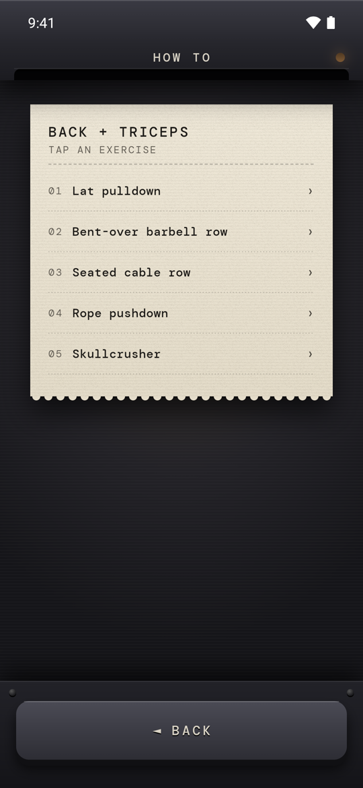
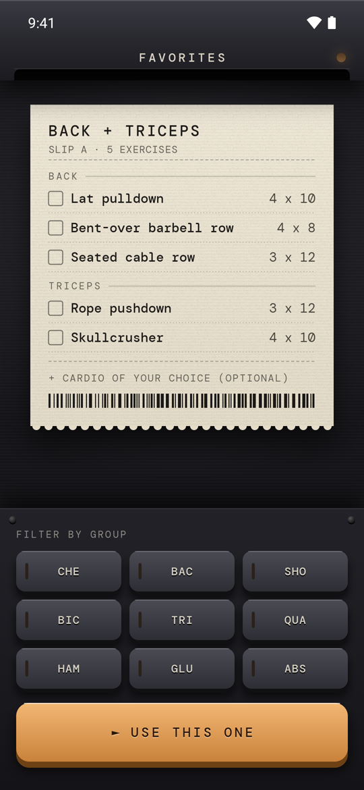

# Setslip

[](https://github.com/edvedovatto/setslip/actions/workflows/build.yml)
[](https://github.com/edvedovatto/setslip/actions/workflows/e2e.yml)

An Android app that prints gym workout slips. Pick up to three muscle groups, press print, and a thermal printer feeds out a slip with the exercises, sets and reps. Tick them off as you go, cross out the ones you skip, keep the good slips as favorites.

The app is in Portuguese and English and works fully offline.

<table>
  <tr>
    <td align="center"><br><sub>A fresh slip</sub></td>
    <td align="center"><br><sub>Checking exercises off</sub></td>
    <td align="center"><br><sub>How to do each one</sub></td>
    <td align="center"><br><sub>Favorites</sub></td>
  </tr>
</table>

## What is in here

| Folder | What it is |
| --- | --- |
| `app/` | The Android app (Kotlin, Jetpack Compose) with its unit tests |
| `e2e-appium/` | End-to-end suite (Java, Appium, Cucumber) |
| `.github/workflows/` | CI: build and unit tests on every push, end-to-end suite every night and on demand |
| `licenses/` | Credits for the sounds, the font and the exercise database |

## The app

- Kotlin 2.4, Jetpack Compose (custom drawn UI, no Material components)
- minSdk 26, targetSdk 36
- No network permission, no analytics, no accounts. Settings, favorites and crossed-out exercises are stored on the device with DataStore.

Build and run the unit tests:

```bash
./gradlew testDebugUnitTest lintDebug assembleDebug
```

The debug APK ends up in `app/build/outputs/apk/debug/app-debug.apk`.

## End-to-end tests

52 scenarios written in Gherkin, covering printing, tracking the workout, favorites, the how-to screens, settings, what survives a restart, and some accessibility basics (content descriptions, touch target sizes against the Android 48dp guideline and the WCAG 2.2 minimum, checkbox and switch semantics, screen reader announcements).

Stack: Java 17, Maven, Appium 3 with the UiAutomator2 driver, Cucumber 8 on JUnit Platform, AssertJ and Awaitility.

### Running

You need an emulator or a phone with USB debugging, and the Appium server:

```bash
npm install --global appium@3.9.0
appium driver install uiautomator2@8.7.3
appium
```

Install the debug APK on the device, then:

```bash
cd e2e-appium
mvn test -Ddevice.udid=emulator-5554
```

| Property | Default | Use |
| --- | --- | --- |
| `device.udid` | first device found | which emulator or phone to use |
| `app.path` | none | APK to install before the run |
| `appium.url` | `http://127.0.0.1:4723` | Appium server address |
| `wait.seconds` | `15` | how long to wait for the app before failing |
| `record.video` | `false` | record the screen and attach the video to failed scenarios |
| `cucumber.filter.tags` | `not @known-issue` | e.g. `"@smoke"` or `"@known-issue"` |

Tags:

- `@smoke` for a quick pass, plus `@regression`, `@accessibility` and `@persistence`.
- `@animations` marks scenarios that follow the print animation. They are skipped, with the reason in the report, when the device has animations turned off.
- `@known-issue` marks checks that fail on purpose because the app still has the problem (some slip and header controls are below the 48dp touch target). They stay out of the normal run and CI runs them separately, so the problem shows in every report without blocking the build.

Reports go to `target/cucumber-reports/` (HTML and JUnit XML). A failed scenario gets the screen, the view hierarchy, the logcat lines from that scenario and, with `record.video`, a screen recording. Assertion failures are reported as failures and environment problems as errors, so triage starts in the right place.

### How the suite is organised

```
e2e-appium/src/test
├── java/com/vedovatto/setslip/e2e
│   ├── config     settings read from system properties
│   ├── driver     one Appium session per run
│   ├── hooks      clean app before each scenario, evidence on failure
│   ├── screens    page objects, one per screen
│   ├── steps      step definitions, grouped by feature
│   └── support    waits, app control, parameter types
└── resources/features
```

A few choices worth knowing about:

- **One session, clean data.** The Appium session opens once per run. Before each scenario the app is stopped and its data cleared, so every scenario starts from a fresh install state without paying for a new session.
- **Wait for outcomes, not for states in between.** The print animation takes about four seconds. Steps wait for the slip to change and the panel to unlock, never for the short-lived "printing" state, and there is no `Thread.sleep` anywhere.
- **Stable locators.** Compose test tags are exposed as resource ids, so the suite does not depend on texts, language or layout position. No XPath.
- **Actions that set a state.** `favorite()`, `check()` and similar only tap when needed and then wait for the result, so they are safe to call twice.
- **Strict parameters.** Group names and languages are typed Cucumber parameters, so a typo in a feature file is an undefined step, not a failure halfway through a scenario.
- **Formatting.** Spotless with google-java-format (AOSP style, pinned version). `mvn spotless:apply` fixes it, CI checks it.

## CI

- `build`: runs on every push and pull request. Unit tests, lint, debug and release builds, plus a format check and compile of the end-to-end suite.
- `e2e`: boots an Android emulator (API 36, snapshot cached between runs), starts Appium and runs the suite with screen recording on. It runs `@smoke` every night, the full suite every Monday, and any tag expression when started by hand from the Actions tab. Known issues run in a separate pass that does not fail the job; a warning shows when one of them starts passing (the bug was fixed) or fails for a reason other than an assertion. Reports, videos, the Appium log and logcat are uploaded as artifacts.

## Credits

Exercise photos and metadata come from [free-exercise-db](https://github.com/yuhonas/free-exercise-db) (public domain); the how-to instructions are written for the app. Sounds are CC0 recordings from Freesound and the slip font is DM Mono (SIL Open Font License). Details in `licenses/`.

## License

The code is released under the MIT License, see `LICENSE`. Third-party assets keep their own licenses, listed above.
